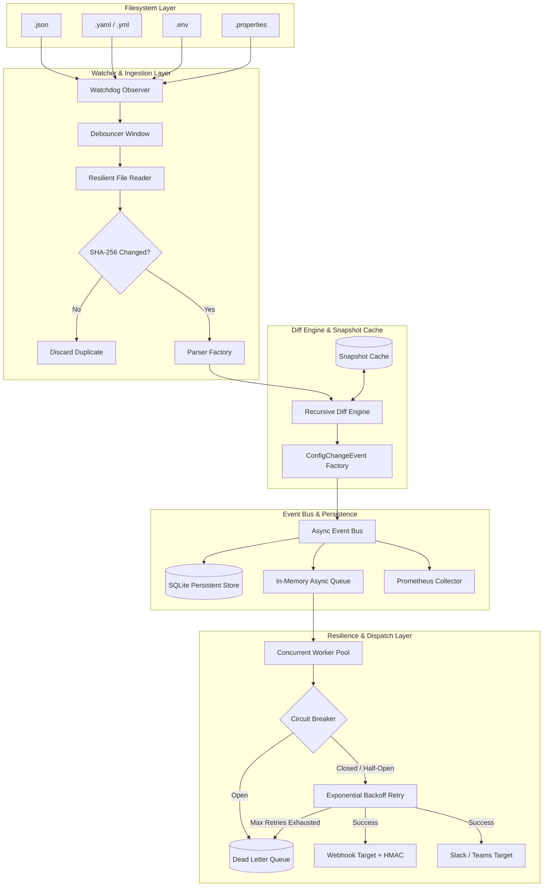

# ⚡ Configuration Change Monitoring System

A production-grade, asynchronous backend service built with **Python 3.13**, **FastAPI**, **Watchdog**, and **Event-Driven Architecture**. The system continuously monitors multi-format configuration files (`.env`, `.json`, `.yaml`, `.properties`), detects structured mutations (added, updated, removed, type-changes), and reliably publishes events to external targets with **exponential backoff**, **3-state circuit breakers**, and a **Dead Letter Queue (DLQ)**.

---

## 📑 Table of Contents
1. [Key Features](#-key-features)
2. [Architecture & System Design](#-architecture--system-design)
3. [Quickstart: How to Run with Python & FastAPI](#-quickstart-how-to-run-with-python--fastapi)
4. [Structured Change Event Format](#-structured-change-event-format)
5. [Reliability & Fault Tolerance Patterns](#-reliability--fault-tolerance-patterns)
6. [Observability & Prometheus Metrics](#-observability--prometheus-metrics)
7. [REST API Reference](#-rest-api-reference)
8. [Testing Suite](#-testing-suite)
9. [Deployment (Docker & Kubernetes)](#-deployment-docker--kubernetes)
10. [Architecture Trade-offs & Scaling Strategy](#-architecture-trade-offs--scaling-strategy)

---

## 🚀 Key Features

- **Multi-Format Configuration Support**:
  - `.json` (Resilient JSON with parse error recovery)
  - `.yaml` / `.yml` (Single and multi-document YAML)
  - `.env` (Type inference for booleans, numbers, quotes, and comments)
  - `.properties` (Java/Spring properties with backslash continuation and escape characters)
- **Advanced Change Detection Engine**:
  - Dot-notated nested key flattening (e.g. `db.host`, `logging.level`)
  - Identifies `added`, `removed`, `updated` (with `old` and `new`), and `type_changes` (e.g., `string` → `object`, `integer` → `string`)
- **Performance & Scalability**:
  - **Thread-safe Debouncing**: Merges burst OS file modifications into single events.
  - **SHA-256 Content Hashing**: Eliminates redundant diff computations when file content is unchanged.
  - Supports monitoring **1000+ files** simultaneously.
- **Resilient Notification Delivery Pipeline**:
  - Asynchronous event bus decoupling the watcher from notifiers.
  - Exponential backoff with randomized full jitter.
  - 3-State **Circuit Breaker** (`CLOSED`, `OPEN`, `HALF_OPEN`) to prevent cascade failures.
  - **Dead Letter Queue (DLQ)** with manual and automated replay APIs.
  - **HMAC-SHA256 Signature Verification** (`X-Hub-Signature-256`) for webhook security.
- **Observability**:
  - Structured JSON and formatted console logging.
  - Prometheus `/metrics` endpoint (latencies, counts, failure rates, DLQ depth, circuit states).
  - Modern Glassmorphism Web UI Dashboard at `/dashboard`.

---

## 🏛️ Architecture & System Design

The system implements **Hexagonal / Layered Architecture** with distinct separation of concerns:



---

## 💻 Quickstart: How to Run with Python & FastAPI

### 1. Prerequisites
- Python 3.10+ (Tested on **Python 3.13.5**)
- Git & pip

### 2. Installation & Setup
Navigate to the project directory:
```bash
cd d:\AllProjects\FastApi\projects_anti\config_change_monitor
```

Install dependencies:
```bash
pip install -r requirements.txt
```

*(Optional)* Review and customize environment settings in `.env`:
```ini
APP_HOST=0.0.0.0
APP_PORT=8000
LOG_LEVEL=INFO
LOG_FORMAT=console
DEBOUNCE_INTERVAL_SECONDS=0.5
WEBHOOK_URL=http://localhost:8000/api/v1/test-webhook
WEBHOOK_SECRET=super-secret-signature-key
```

### 3. Running the Server

#### Method A: Direct Python Execution (Recommended)
```bash
python src/main.py
```

#### Method B: Uvicorn CLI with Hot Reloading
```bash
python -m uvicorn src.api.app:app --host 0.0.0.0 --port 8000 --reload
```

The service will boot:
- **Interactive UI Dashboard**: [http://localhost:8000/dashboard](http://localhost:8000/dashboard)
- **Interactive OpenAPI Documentation (Swagger)**: [http://localhost:8000/docs](http://localhost:8000/docs)
- **Prometheus Metrics**: [http://localhost:8000/metrics](http://localhost:8000/metrics)
- **System Health**: [http://localhost:8000/health](http://localhost:8000/health)

---

## 📦 Structured Change Event Format

When a monitored file changes, the system generates a standardized event compliant with the specification:

```json
{
  "id": "ea276f56-9123-4645-ad49-915fbd12c219",
  "file": "config.yaml",
  "event_type": "modified",
  "timestamp": "2026-10-15T12:04:21.686392Z",
  "changes": {
    "added": {
      "logging.level": "debug"
    },
    "updated": {
      "db.host": {
        "old": "localhost",
        "new": "prod-db"
      }
    },
    "removed": {
      "cache.enabled": true
    },
    "type_changes": {
      "featureFlags": {
        "oldType": "string",
        "newType": "object"
      }
    }
  },
  "metadata": {}
}
```

---

## 🛡️ Reliability & Fault Tolerance Patterns

| Failure Scenario | Mitigation Pattern |
|---|---|
| **Partial / In-flight Writes** | `ResilientFileReader` retries file reads with backoff when a file is temporarily locked or 0 bytes during atomic file saves. |
| **Corrupted / Invalid Syntax** | `ParserError` is isolated; the file status updates to `invalid_syntax` while retaining the previous valid snapshot in cache so future valid fixes diff accurately. |
| **Downstream Webhook Outage** | **3-State Circuit Breaker** opens after $N$ consecutive failures, blocking calls to prevent thundering herd and timeouts. |
| **Transient Network Drops** | **Exponential Backoff with Full Jitter** retries $M$ times with configurable base and maximum delays. |
| **Permanent Delivery Failures** | Events transition to the **Dead Letter Queue (DLQ)** with error details, timestamp, and attempt counts. |
| **Recovery & Replay** | Operators can inspect DLQ records and trigger on-demand redelivery via `POST /api/v1/dlq/replay/{record_id}`. |

---

## 📊 Observability & Prometheus Metrics

Exposed at `GET /metrics` for Prometheus scraping:

| Metric Name | Type | Description |
|---|---|---|
| `config_changes_detected_total` | Counter | Total configuration changes detected (labeled by `file`, `event_type`). |
| `config_keys_mutated_total` | Counter | Keys altered (labeled by `file`, `category`: `added`, `updated`, `removed`, `type_changes`). |
| `config_notification_dispatches_total` | Counter | Delivery attempts (labeled by `target`, `status`: `success`, `failure`, `circuit_breaker_open`). |
| `config_change_processing_latency_seconds` | Histogram | End-to-end latency from file detection to notification completion. |
| `config_monitored_files_active` | Gauge | Active count of tracked configuration files. |
| `config_dlq_records_count` | Gauge | Number of records currently awaiting replay in the DLQ. |
| `config_circuit_breaker_state` | Gauge | Current state of target circuit breakers (0 = `CLOSED`, 1 = `HALF_OPEN`, 2 = `OPEN`). |

---

## 🔌 REST API Reference

| Method | Endpoint | Description |
|---|---|---|
| `GET` | `/health` | Health check with uptime, queue depth, active files, and circuit breaker states. |
| `GET` | `/files` | List all monitored configuration files with sizes, formats, and checksums. |
| `GET` | `/events` | Paginated query of recent change events (`limit`, `offset`, `file`). |
| `POST` | `/watch` | Add a new file or directory to monitor (`{"path": "./sample_configs"}`). |
| `DELETE` | `/watch/{path}` | Stop monitoring a file or directory. |
| `GET` | `/metrics` | Prometheus metrics scrape endpoint. |
| `GET` | `/api/v1/dlq` | List all failed records in the Dead Letter Queue. |
| `POST` | `/api/v1/dlq/replay/{id}` | Replay an undelivered DLQ event to its target. |
| `POST` | `/api/v1/test-webhook` | Built-in mock receiver capturing payload and HMAC signature. |
| `GET` | `/api/v1/test-webhook/history` | Retrieve history of payloads received by the test webhook. |
| `POST` | `/api/v1/simulate-change` | Trigger a test mutation in `sample_configs/config.yaml` for live verification. |

---

## 🧪 Testing Suite

Run all unit and integration tests with pytest:
```bash
python -m pytest -v
```

Run test suite with coverage report:
```bash
python -m pytest --cov=src --cov-report=term-missing
```

The test suite covers:
- **Parser Unit Tests**: Validation of valid/invalid syntax for JSON, YAML, .ENV, and .Properties.
- **Diff Engine Unit Tests**: Flat/nested added, updated, removed, and type changes matching the assignment spec.
- **Circuit Breaker Unit Tests**: State transitions, threshold tracking, recovery timeouts, and trial probes.
- **Debouncer Unit Tests**: Rapid event burst coalescing.
- **End-to-End Integration Tests**: File modification $\rightarrow$ event bus $\rightarrow$ queue $\rightarrow$ webhook payload delivery $\rightarrow$ SQLite audit store $\rightarrow$ DLQ routing and replay.

---

## 🐳 Deployment (Docker & Kubernetes)

### Docker Run
```bash
# Build Docker image
docker build -t config-change-monitor:latest .

# Run container
docker run -d -p 8000:8000 --name config_monitor config-change-monitor:latest
```

### Docker Compose
```bash
docker-compose up -d
```

### Kubernetes Manifests
Deploy the production deployment, service, and configmap:
```bash
kubectl apply -f k8s/configmap.yaml
kubectl apply -f k8s/deployment.yaml
kubectl apply -f k8s/service.yaml
```

---

## 📐 Architecture Trade-offs & Scaling Strategy

### 1. In-Memory Queue vs. Distributed Broker (Kafka/RabbitMQ/Redis)
- **Current Approach**: Async in-memory queue with backpressure limits.
- **Trade-off**: Zero infrastructure overhead, ultra-low latency, and simple local development.
- **Scaling Path (1000+ files / Horizontal Scaling)**: The `EventBus` interface is decoupled from the storage and queue. In distributed multi-replica environments, replace `AsyncEventQueue` with a Redis Stream or Kafka topic producer to distribute change events across horizontally scaled notification worker pods.

### 2. Snapshot Caching vs. Disk Re-reading
- **Current Approach**: Parsed dictionary snapshots cached in memory (`SnapshotCache`) combined with SHA-256 hashes (`HashCache`).
- **Trade-off**: Uses small memory footprint (~20-50 KB per file) in exchange for $O(1)$ lookup and bypassing filesystem I/O and repetitive parsing.
- **Scaling Path**: Support Redis-backed snapshots with TTL for multi-node deployments.

### 3. At-Least-Once Delivery
- Events are enqueued before ACK and persisted to SQLite audit log. If a worker pod crashes mid-dispatch, events in DLQ or persistent audit logs can be replayed safely because payloads include unique idempotent UUIDs (`event_id`).
